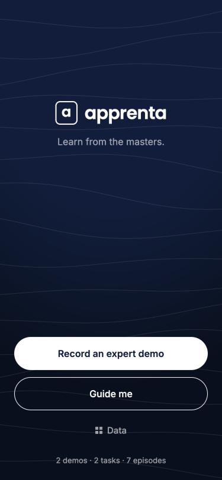
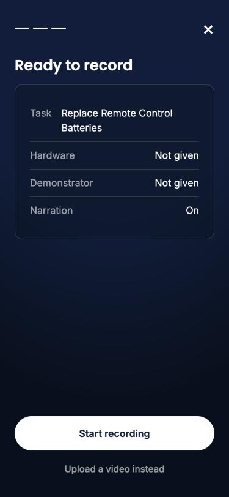
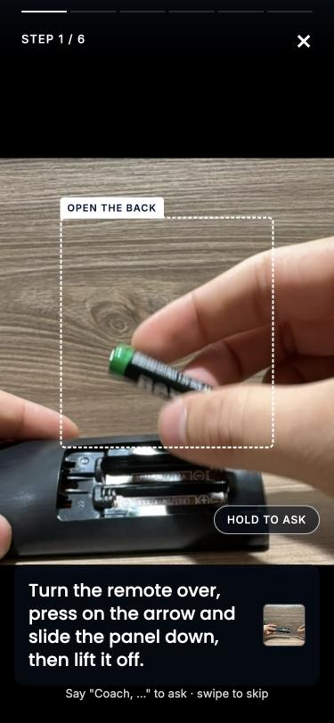
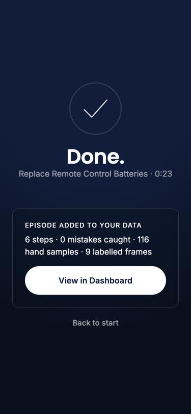
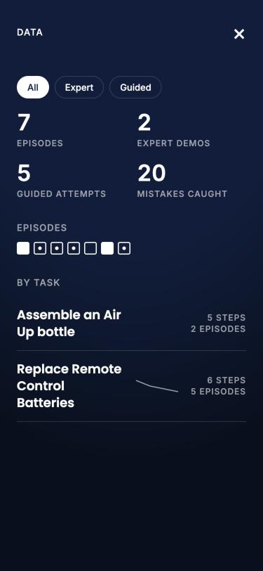
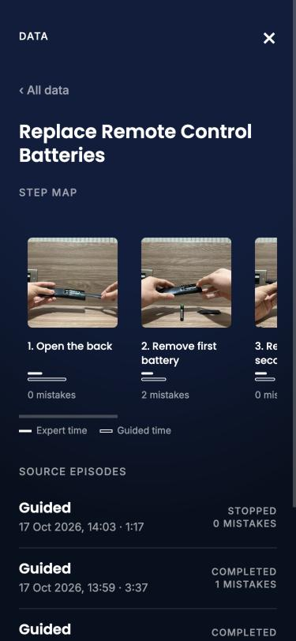
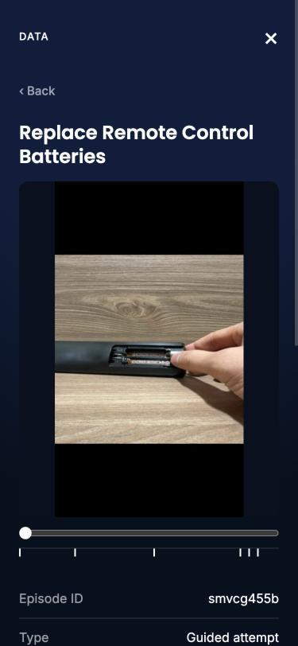

# Apprenta

Help people today. Teach robots tomorrow.

An expert records a hands on task once, talking through it. Apprentice turns that recording into a step by step guide. Anyone can then clip their phone to their chest and get live, spoken coaching while they do the task themselves: it watches their hands, checks each step against the expert's reference, catches mistakes and answers questions out loud. No screen and no buttons needed.

Every session becomes a robot learning episode. Expert demos show how a task should go. Guided attempts show how it goes wrong and gets fixed: hand trajectories, labelled frames, step boundaries, mistakes, corrections and spoken intent.

Built at the Physical AI Hack, London, 17 October 2026.

## Screens

| Start | Record | Live guidance | Done |
|:---:|:---:|:---:|:---:|
|  |  |  |  |
| One hub, three modes | One question per screen | The coach watches and speaks, the box follows the work | Every session becomes an episode |

| Data | Step map | Episode |
|:---:|:---:|:---:|
|  |  |  |
| Every figure traces back to its episodes | Expert vs guided time and mistakes per step | Frames, steps, mistakes and raw data, ready to export |

## How it works

1. **Record.** The expert films the task (in the browser, or uploads a video from the phone's camera app) and narrates it. Frames are sampled every 1.5 s, the narration is transcribed with timestamps, and hands are tracked on device.
2. **Build.** An OpenAI vision model reads the frames and narration and writes a guide written for the ear: short spoken instructions, a "done when" end state that a chest camera can see, visible common mistakes, and a reference frame for each step. The guide can be edited before use.
3. **Guide.** The coach speaks every instruction and listens for "Coach, ..." to answer questions or follow commands (next, repeat, go back, check). Background chatter without the wake word is ignored.
4. **Data.** Every check is saved as a labelled frame. Hand landmarks (21 keypoints per hand, about 10 Hz), step events, mistakes, corrections and questions are logged per session and exported as a zip (`episode.json` plus frames).

## How it stays fast and accurate

Robots split perception into a fast local layer and a slow reasoning layer. Apprentice does the same on a phone:

* **Fast layer, on the phone.** MediaPipe tracks the hands about 10 times a second and crops each frame around the work area, so small details like battery polarity stay sharp.
* **Slow layer, in the cloud.** A fast vision model (gpt-4.1-mini) judges each step. Checks overlap: a new frame goes out about every second with up to three in flight, and the newest capture always wins, so updates arrive about once a second even though each check takes 2 to 3 s.
* **It only speaks when sure.** A mistake is spoken only when two of the last three checks agree, and only once. A step completes when two of the last three checks say done. If the fast model keeps saying it is unsure, a stronger model (gpt-4.1) looks at a sharper image.
* **Instant audio.** Every fixed line is generated by ElevenLabs when the session starts, and a local chime confirms each step immediately.

The next step is the one robotics companies take: train small, task specific detectors on the episodes Apprentice collects, so the checks run on the device in real time.

## Tech

* Backend: Python, FastAPI
* Vision and reasoning: OpenAI chat completions with image input (gpt-5 builds guides, gpt-4.1-mini checks steps, gpt-4.1 verifies unsure cases; all configurable)
* Speech to text: OpenAI Whisper and gpt-4o-mini-transcribe
* Text to speech: ElevenLabs (falls back to the browser voice)
* Hand tracking: MediaPipe Hand Landmarker, running in the browser
* Frontend: plain HTML, CSS and JavaScript, no build step
* Video processing: ffmpeg

## Run it

```bash
python3 -m venv .venv
.venv/bin/pip install -r requirements.txt
cp .env.example .env   # then add your keys
.venv/bin/uvicorn app:app --host 0.0.0.0 --port 8000
```

Open http://localhost:8000 on the laptop. Phones need HTTPS to use the camera, so expose the server with a tunnel:

```bash
cloudflared tunnel --url http://localhost:8000
```

Without an OpenAI key the app runs in demo mode with scripted responses, so the whole flow can be tried offline.

## Data format

Each exported episode contains:

* `episode.json`: task, steps, role (expert or novice), transcript, events (step start, check results, mistakes, step done, questions), labelled frames, hand landmarks
* `frames/`: the JPEG frames that were checked, matched to the labels in `episode.json`
